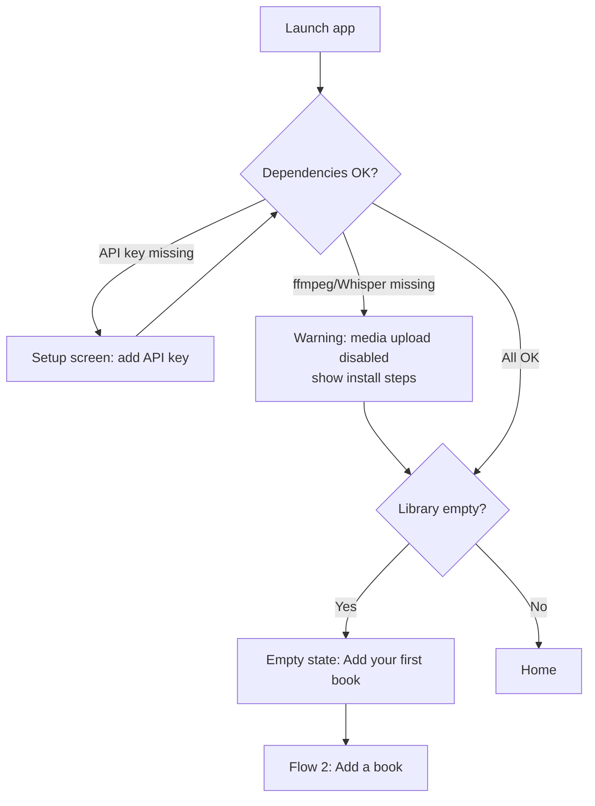
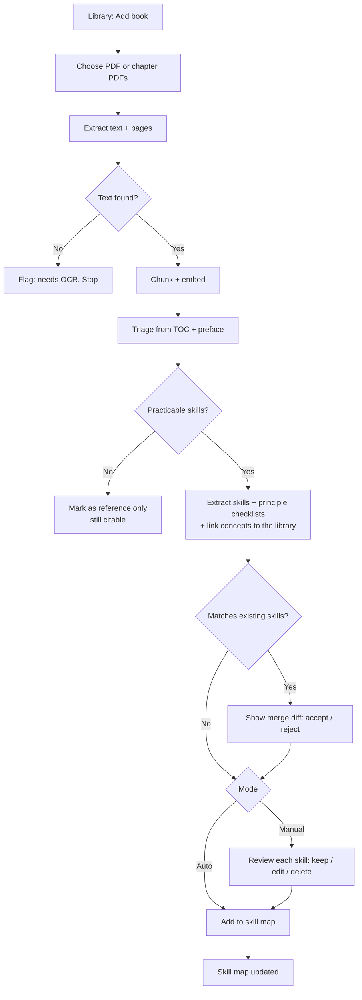
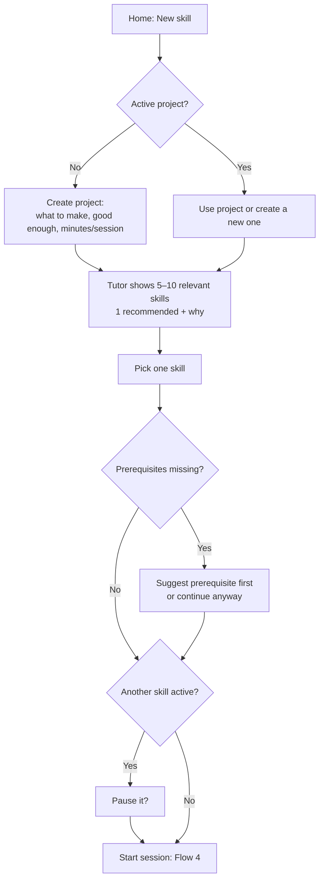
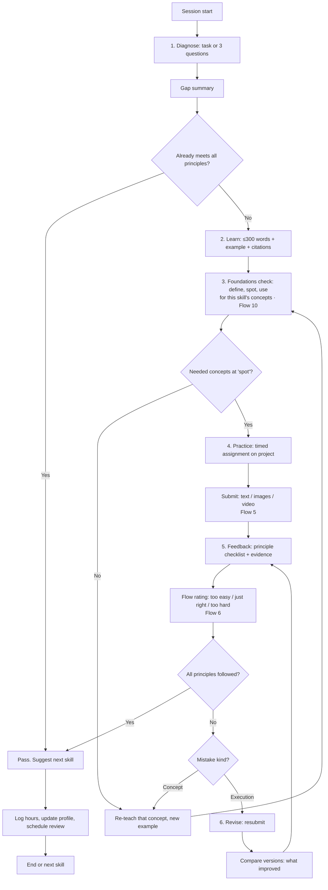
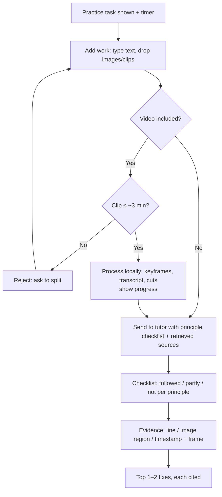
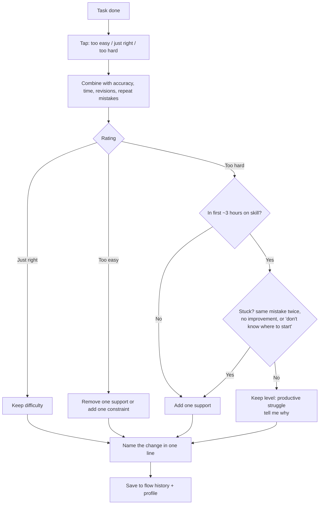
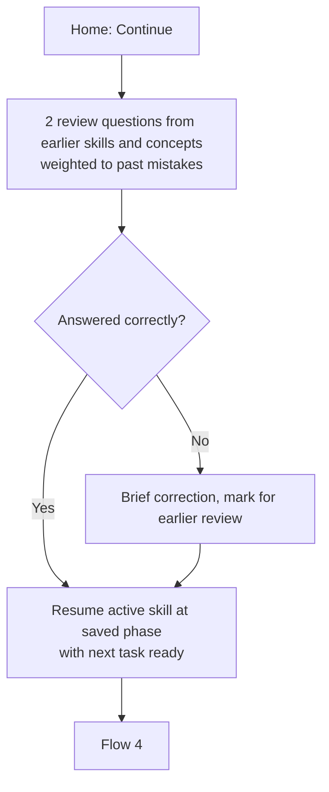
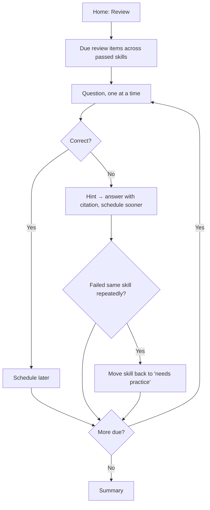
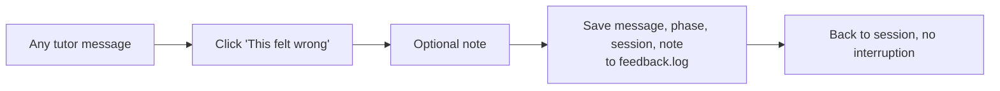
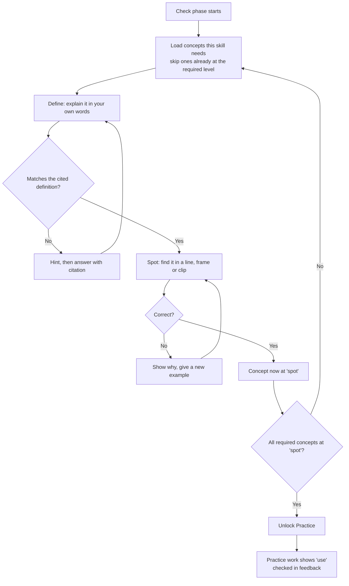

# AI Tutor: User Stories and User Flows

Companion to `SPEC.md`. Single user (me), local-only app. Section numbers like §6.3 refer to SPEC.md.

Story format: **As a learner, I want … so that …**, followed by acceptance criteria (AC).
Priority: **P0** = MVP, **P1** = soon after, **P2** = later.

---

## Part 1: User stories

### Epic A: First run and setup

**A1 (P0): Check my machine.** I want the app to check on first launch that ffmpeg, Whisper, and my language model server (OpenAI-compatible URL, model, optional key) are set up, so I don't hit errors halfway through a session.
- AC: Startup screen lists each dependency as ready or missing, with a one-line fix for each one.
- AC: Text-only learning still works if only the media tools are missing; image and video upload are disabled with a note.

**A2 (P0): Empty state guides me.** I want a first-run screen that tells me the one thing to do next (add a book), so I'm not facing an empty dashboard.

### Epic B: Library and skill map

**B1 (P0): Upload a book.** I want to upload a PDF or chapter PDFs, so the tutor can teach from my own sources.
- AC: Shows progress: extracting → chunking → triage → skills.
- AC: Chapter PDFs from my chapter-splitter app are grouped under one book.
- AC: Scanned PDFs without text are flagged ("needs OCR"), not silently failed.

**B2 (P0): See what a book is good for.** I want a short triage per book (book type, likely skills, or "no practicable skills"), so I know whether it's worth teaching from.

**B3 (P0): Get practicable skills.** I want each book broken into small skills phrased as things I can *do*, each with a principle checklist and sources, so I can learn by practicing.
- AC: Each skill shows its name, a one-line description, 2–6 principles with citations, prerequisites, and a practice type.

**B4 (P0): Edit the skill map.** I want to rename, delete, split or merge skills and edit principles, so the map matches how I think.
- AC: Auto mode accepts extracted skills directly; manual mode asks me to approve each one.

**B5 (P1): Merge books.** I want skills from a new book on the same topic merged into existing skills (adding sources and principles), so I don't get duplicates.
- AC: The merge is shown as a diff ("adds 2 principles to *Scene want/obstacle*"), and I can accept or reject it.

**B6 (P0): Open a source passage.** I want to click any citation and see the exact passage and page, so I can trust what I'm taught.

**B7 (P0): Build a concepts library.** I want the fundamental terms and principles from my books pulled into a shared library, so I learn each fundamental once and reuse it across skills.
- AC: Each concept has a plain-words definition, one film example, citations, and the skills that use it.
- AC: Concepts used by many skills are flagged as foundations.
- AC: A concept found in a second book is linked, not duplicated.

### Epic C: Projects and choosing a skill

**C1 (P0): Start from a project.** I want to describe what I want to make, what "good enough" means, and my session length, so practice serves real work.

**C2 (P0): Get a short list, not a curriculum.** I want 5–10 relevant skills with one recommended first and why, so I'm not overwhelmed.
- AC: The full skill map is never presented as a plan; only this short list.
- AC: Missing prerequisites are flagged on a skill ("needs *X* first").

**C3 (P0): One active skill.** I want only one skill active at a time, so I stay focused.
- AC: Starting a new skill asks me to pause the current one.

### Epic D: The teaching session

**D1 (P0): Diagnose first.** I want a short task or 3 questions before any teaching, so the tutor skips what I already know.
- AC: Ends with a 1–2 sentence summary of what I can do and what the gap is.
- AC: Covers the skill's key concepts; concepts I already spot and use are skipped.

**D2 (P0): Learn just enough.** I want an explanation of 300 words or less, with one example and citations, so I can start practicing fast.

**D3 (P0): Foundations check.** I want short questions on the concepts this skill depends on, at three levels (define, spot, use), so I know my fundamentals are solid before I practice.
- AC: One question at a time, with a hint before the answer.
- AC: Spot questions use real examples: lines of dialogue, storyboard frames, or clip moments.
- AC: Practice stays locked until every required concept reaches spot, and the screen says which ones are missing.
- AC: The whole check takes 2–5 minutes.

**D4 (P0): Timed practice on my project.** I want an assignment applied to my project, with a timer, so I'm producing real work.
- AC: The timer is visible and can be paused. Going over time is allowed and gets logged.

**D5 (P0): Submit text, images, or video.** I want to submit any mix of text, images and video clips, so I can practice film skills, not only writing.
- AC: Video over about 3 minutes is rejected with a message to split it.
- AC: While a video is processing, the app shows its progress (frames, transcript, cuts).

**D6 (P0): Principle-based feedback.** I want each principle marked followed, partly, or not followed, with evidence from my work, so feedback is concrete and fair.
- AC: Evidence points to a line, an image region, or a timestamp, and the referenced video frames are shown.
- AC: There are no taste comments beyond the checklist unless I ask.

**D7 (P0): Revise and compare.** I want to resubmit and see what improved between versions, so I can see my progress.

**D8 (P0): Pass a skill.** I want to pass when every principle is followed, then see the suggested next skill, so I always know what's next.

**D9 (P0): Steer me back.** I want the tutor to redirect me when I drift into theory questions mid-practice, so I keep producing.

**D10 (P1): Ask a question anytime.** I want to ask a question during any phase and get an answer grounded in my books, then return to the same phase.

**D11 (P0): Concept or execution?** I want feedback to say whether a mistake came from misunderstanding a concept or from not applying it, so I fix the real cause.
- AC: A concept mistake leads to a short re-teach and check of that concept before the next attempt.
- AC: An execution mistake leads straight back to practice.

### Epic E: Flow and adaptation

**E1 (P0): Rate each task.** I want a one-tap rating (too easy, just right, too hard) after each task, so the next one fits me.

**E2 (P0): One lever at a time.** I want difficulty changed by exactly one lever, with the change named ("Added a template"), so I understand why things got easier or harder.

**E3 (P0): Frustration barrier.** I want the tutor to keep the level when I'm struggling productively and add support only when I'm truly stuck, so I don't quit too early or get coddled.
- AC: When it keeps the level after a "too hard" rating, it says so and why.

**E4 (P0): A profile of how I learn.** I want the app to track my mistakes, the levers that work, and my preferences, so teaching adapts to me.
- AC: I can view and edit the profile.

### Epic F: Progress and review

**F1 (P0): Hours toward 20.** I want to see practice hours per skill toward 20, so I see real progress.

**F2 (P0): Continue where I left off.** I want "Continue" to start with a 2-question review and then resume at the exact phase and task, so restarting takes no effort.

**F3 (P1): Review mode.** I want quiz-only review of passed skills, so I don't forget them.
- AC: A failed review moves the skill back to "needs practice".
- AC: Review includes concepts, mixed across skills; a failed concept drops back to its last secure level.

**F4 (P1): Progress view.** I want to see passed skills, recurring mistakes and flow history.

**F5 (P0): Concepts screen.** I want to see every concept with my level (define / spot / use), foundations first, so I can see which fundamentals are shaky.
- AC: Opening a concept shows its definition, example, sources, the skills that use it, and what I keep confusing it with.
- AC: I can start a 3-minute check on any one concept.

### Epic G: Improving the app by using it

**G1 (P0): "This felt wrong".** I want a button on any tutor message that saves the message and my note, so I can improve the app from real use.
- AC: Saved to `data/feedback.log` with the session, phase and message ID.

---

## Part 2: User flows

### Flow 1: First run

### Flow 2: Add a book → skill map

Edge cases: very large book (show estimated processing time, allow cancelling); duplicate upload (detect the same file and offer to skip).

### Flow 3: New project → choose one skill

### Flow 4: Teaching session (core loop)

Available at any point: ask a question (answer from the books, then return to the same phase), pause (state saved), "This felt wrong" on any message.

### Flow 5: Submitting work and getting feedback

### Flow 6: Flow calibration after each task

### Flow 7: Continue

Edge case: no active skill. Go to Flow 3.

### Flow 8: Review mode (P1)

### Flow 9: "This felt wrong"

### Flow 10: Foundations check (inside phase 3)

Guard: the whole check takes 2–5 minutes. If a concept fails twice, the tutor re-teaches it from a new angle before asking again.

---

## Part 3: Screens these flows need (input for mockups)

| Screen | Used in flows | Key states to mock |
| --- | --- | --- |
| Setup / dependency check | 1 | All OK, API key missing, media tools missing |
| Home | 1, 3, 7, 8 | Empty library, no active skill, active skill with Continue, reviews due |
| Library | 2 | Empty, processing (progress steps), needs OCR, reference only |
| Skill review (manual mode) | 2 | Single skill card with principles and citations, merge diff |
| Skill map | 2, 3 | Grouped by domain, statuses, hours, edit/split/merge |
| Project create/select | 3 | New project form, existing project picker |
| Skill picker | 3 | Short list with recommendation, prerequisite warning, pause-active dialog |
| Session | 4, 5, 6, 9, 10 | Each phase; foundations check (define / spot / use, practice locked); timer; submission area (text/images/video); video processing; checklist feedback with frames; version compare; flow rating; level-kept message; pass screen |
| Source passage viewer | All citations | Passage with page, highlighted chunk |
| Review | 8 | Question, hint, answer, summary |
| Progress | F1, F4 | Hours toward 20, passed skills, recurring mistakes, flow history |
| Profile | E4 | View/edit learner profile |
| Concepts | B7, F5 | Library with levels, foundations first; one concept open with definition, example, sources, skills |

Suggested mockup priority: **Session** (most complex and used most) → **Skill picker** → **Home** → **Library / Skill map** → the rest.
